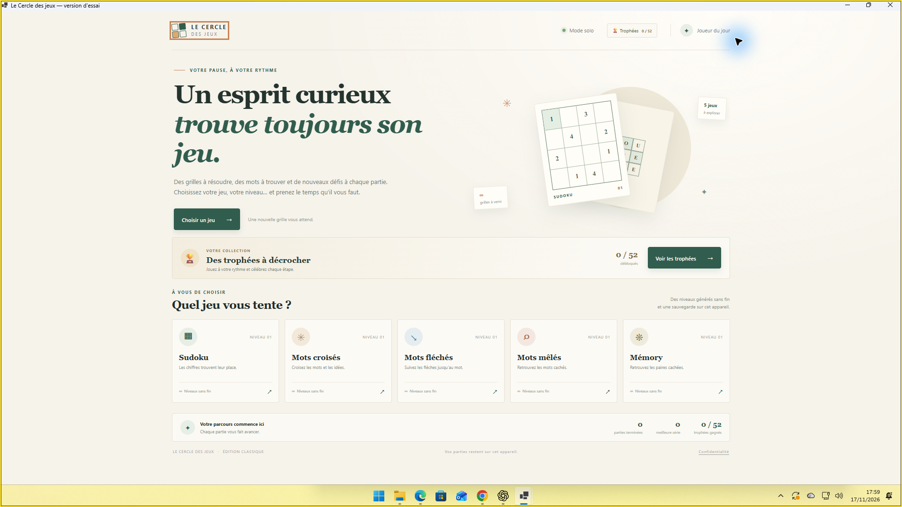

# Le Cercle des jeux

Jeu de réflexion solo : sudoku, mots croisés, mots fléchés, mots mêlés et mémory, avec des niveaux générés sans fin.

## Version d’essai Windows

Télécharger l’[EXE Windows x64](https://github.com/loictinant/Le-Cercle-Des-Jeux/releases/tag/v1.0.0-essai).

Cette édition comprend 52 trophées locaux. La progression et les trophées restent sur l’appareil. Les succès Windows Store et les trophées Android seront intégrés séparément aux applications officielles.

## Code source

L’archive **LeCercleDesJeux-GitHubSource.zip** contient le jeu, les deux propositions visuelles, ainsi que les projets de compilation Windows et Android. Elle ne contient aucun EXE, APK, paquet MSIX ou clé de signature.

Après extraction, les fichiers du jeu se trouvent dans le dossier LeCercleDesJeux. Les scripts de compilation sont dans LeCercleDesJeux/Plateformes/.

## Confidentialité

Le jeu fonctionne en solo hors ligne. Les parties et trophées locaux restent sur l’appareil. Aucun compte ni serveur de jeu n’est requis.

Site de présentation : https://loic-apps.duckdns.org/
