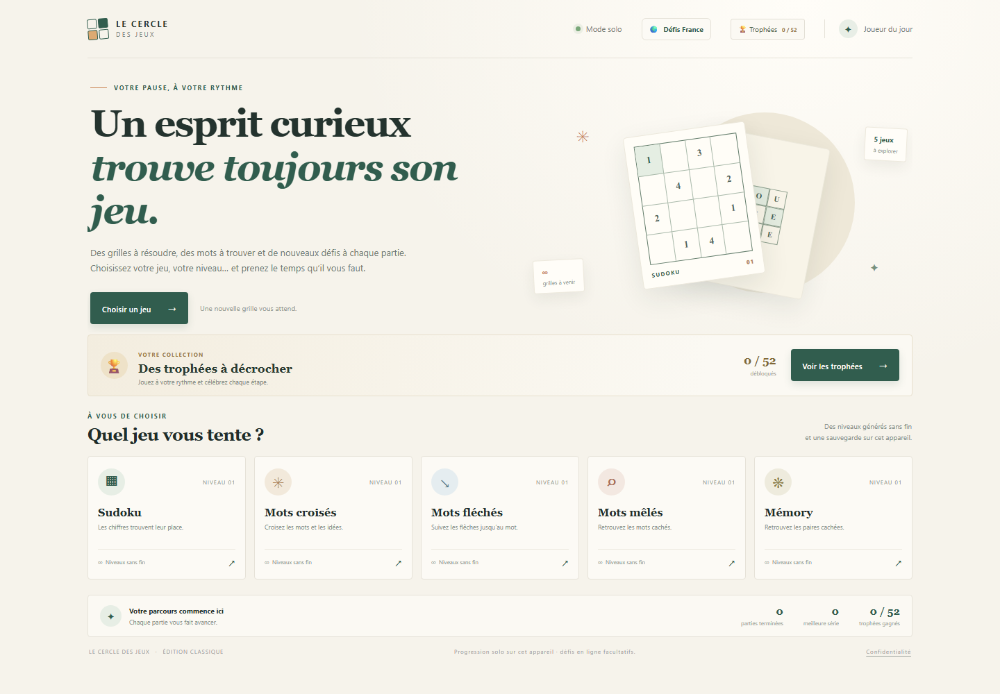

# Le Cercle des jeux — version 1.1.0

Jeu de réflexion en français : sudoku, mots croisés, mots fléchés, mots mêlés et mémory.

## Téléchargement Windows

[ Télécharger l’EXE d’essai Windows x64 ](https://github.com/loictinant/Le-Cercle-Des-Jeux/releases/tag/v1.1.0-essai)

L’essai conserve les 52 trophées internes sur cet appareil. Les succès Xbox/Windows ne sont pas activés dans cette version.

## Défis France

Le jeu propose un défi quotidien identique pour chaque jeu, puis un classement asynchrone par pseudo. Participer au classement est facultatif : les défis restent jouables sans pseudo. Un pseudo anonyme n’est créé qu’après acceptation de la politique de confidentialité.

L’API PHP/MySQL est incluse dans les sources mais reste à installer et configurer sur l’hébergement. Le mode solo continue de fonctionner hors ligne.

## Code source et confidentialité

[ Télécharger les sources Windows, Android, le jeu navigateur et le serveur PHP/MySQL ](LeCercleDesJeux-GitHubSource-v1.1.0.zip)

Les clés de signature et les identifiants de base ne sont pas dans le dépôt. La politique de confidentialité est incluse dans le jeu et dans l’archive du site.

Site : [loic-apps.duckdns.org](https://loic-apps.duckdns.org/index.html)