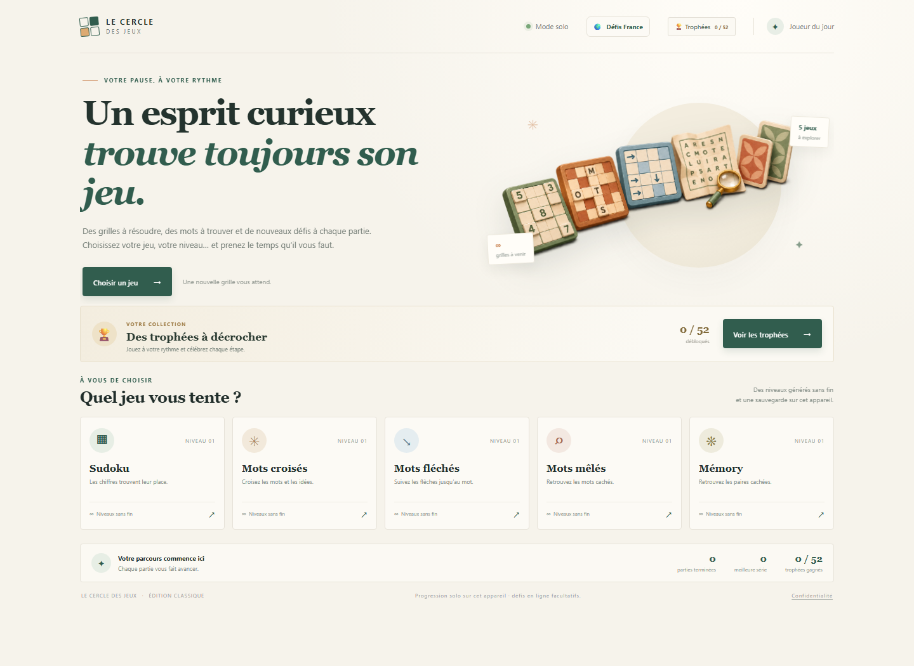

# Le Cercle des jeux — version 1.2.0

Jeu de réflexion en français : sudoku, mots croisés, mots fléchés, mots mêlés et mémory.

## Télécharger l’essai Windows

[Télécharger l’EXE d’essai Windows x64](https://github.com/loictinant/Le-Cercle-Des-Jeux/releases/tag/v1.2.0-essai)

La collection de trophées reste locale à la version utilisée. Les succès Xbox/Windows ne sont pas activés.

## Défis France

Le même défi quotidien est proposé à tous les joueurs, avec un classement différé par jeu. Le pays reste réglé sur la France : le jeu ne consulte pas la localisation de l’appareil. La participation est facultative et demande un accord explicite.

Le pseudo public est choisi par le joueur, doit être unique, et peut être modifié ensuite. Pour activer cette fonction, remplacer le fichier `public_html/lecercle-api/v1/index.php` sur l’hébergement avec celui de l’archive du site 1.2.0. La base et son fichier `config.php` ne changent pas.

## Sources et site

[Télécharger les sources Windows, Android, les deux propositions visuelles et l’API PHP/MySQL](LeCercleDesJeux-GitHubSource-v1.2.0.zip)

Le jeu solo continue de fonctionner hors ligne. Les clés de signature et les identifiants MySQL ne figurent pas dans les sources publiques.

Site : [loic-apps.duckdns.org](https://loic-apps.duckdns.org/index.html)
